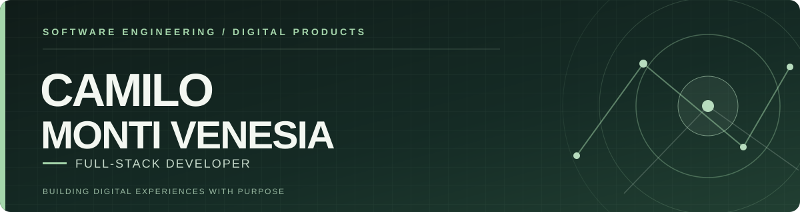
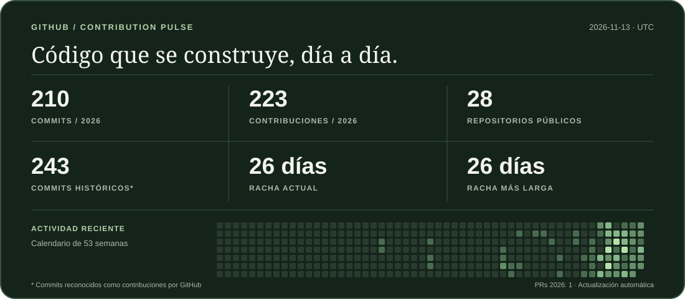

 

**Construyo experiencias web completas.**

Frontend sólido. Backend funcional. Productos digitales pensados de principio a fin.

**Rosario, Argentina**

 

 

**React · TypeScript · Node.js · PostgreSQL · MongoDB · Supabase**

---

## GitHub Activity

**Commits, contribuciones y constancia de desarrollo.**

<picture>
  <source media="(prefers-color-scheme: dark)" srcset="./assets/stats-dark.svg">
  <source media="(prefers-color-scheme: light)" srcset="./assets/stats-light.svg">
  
</picture>

Estadísticas generadas automáticamente mediante GitHub Actions. Las cifras corresponden a contribuciones reconocidas por GitHub.

---

## Technology Stack

### Frontend & Languages

  

`React Router` `Motion` `Responsive Design` `AOS` `Lenis`

### Backend & Databases

  

`REST APIs` `SQL` `Mongoose` `JWT` `Zod` `RBAC` `Firestore`

### Development & Tools

  

`Render` `Vitest` `Mocha` `Supertest` `ESLint` `Prettier` `Swagger` `Nodemailer` `Leaflet`

---

## About Me

Soy **Camilo Monti Venesia**, desarrollador Full Stack de Rosario, Argentina, enfocado en construir aplicaciones que integren **buen diseño, lógica de negocio, persistencia de datos y experiencias de usuario cuidadas**.

Me gusta desarrollar proyectos de principio a fin: desde la planificación de la interfaz hasta la arquitectura de servicios, la seguridad, las pruebas y el despliegue.

Actualmente sigo desarrollando productos digitales y mejorando continuamente su arquitectura, accesibilidad y rendimiento.

### Let's build something great.

¿Tenés una oportunidad profesional, una propuesta freelance o un proyecto en mente?

[**Portfolio**](https://portafolio-camilo-monti-venesia.vercel.app/) · [**LinkedIn**](https://www.linkedin.com/in/camilovenesia/) · [**Email**](mailto:camilovenesia.dev@gmail.com)

---

## Selected Work

Aplicaciones y soluciones digitales que desarrollé combinando diseño de interfaces, arquitectura backend, bases de datos y experiencia de usuario.

### 01 — Portfolio Personal

**Mi espacio profesional como desarrollador Full Stack.**

Portfolio diseñado y desarrollado desde cero para presentar mis proyectos, habilidades y trayectoria profesional. Combina una identidad visual propia con interacciones, animaciones y una experiencia adaptable a diferentes dispositivos.

**Características:** modo claro y oscuro, navegación interactiva, optimización SEO, presentación de proyectos y formulario de contacto con backend propio mediante Vercel Functions y SMTP.

`React` `JavaScript` `Vite` `Node.js` `Nodemailer` `AOS` `Lenis`

**[Ver portfolio](https://portafolio-camilo-monti-venesia.vercel.app/) · [Código fuente](https://github.com/CamiloVenesia/Portfolio-personal)**

---

### 02 — La Matera

**E-commerce de mates, termos y accesorios.**

Tienda online desarrollada con React y Firebase, con una experiencia de compra completa y una identidad visual orientada al producto.

**Características:** catálogo dinámico, búsqueda, filtros, carrito persistente, checkout conectado con Firestore y control de stock mediante transacciones.

`React` `Vite` `JavaScript` `Firebase` `Firestore`

**[Ver repositorio](https://github.com/CamiloVenesia/E-Commerce-LaMatera)**

---

### 03 — Kinetic Gym

**Sistema Full Stack de gestión para gimnasios.**

Plataforma administrativa para gestionar socios, membresías, pagos, vencimientos e ingresos de un gimnasio.

**Características:** dashboard de métricas, historial de pagos, roles administrativos, autenticación JWT y modo kiosco para registrar accesos mediante DNI.

`JavaScript` `Node.js` `Express` `MongoDB` `Mongoose` `JWT`

**[Ver demo](https://kinetic-gym-api.onrender.com) · [Código fuente](https://github.com/CamiloVenesia/kinetic-gym-api)**

---

### 04 — Ritmo Pádel

**Sistema de reservas deportivas con experiencia visual interactiva.**

Aplicación Full Stack para un club ficticio de pádel que combina una interfaz premium con un sistema de reservas, usuarios y administración.

**Características:** cancha interactiva, disponibilidad por fechas y horarios, autenticación, reservas y cancelaciones, panel administrativo y prevención de reservas superpuestas en PostgreSQL.

`React` `TypeScript` `Express` `PostgreSQL` `Docker` `Vitest`

**[Ver demo](https://ritmo-padel-app.onrender.com) · [Código fuente](https://github.com/CamiloVenesia/ritmo-padel)**

---

### 05 — NEXO CRM

**Gestión comercial, colaboración y análisis empresarial.**

Plataforma CRM para centralizar empresas, contactos, oportunidades comerciales y actividades de equipos.

**Características:** pipeline Kanban, calendario, tareas, mensajería interna, notificaciones, reportes y control de acceso mediante Supabase Authentication y Row Level Security.

Incluye una demostración pública con datos ficticios, aislada de la información real.

`React` `TypeScript` `Vite` `Supabase` `PostgreSQL` `RLS` `Vitest`

**[Explorar demo](https://nexo-crm-oficial.vercel.app/?demo=1) · [Código fuente](https://github.com/CamiloVenesia/nexo-crm)**

---

### 06 — DeliveryOps

**Plataforma de gestión de entregas y operaciones logísticas.**

Aplicación Full Stack para organizar pedidos, entregas, repartidores y procesos logísticos mediante un frontend React y una API REST.

**Características:** gestión de pedidos, asignaciones, seguimiento de entregas, autenticación JWT, permisos por roles, documentación OpenAPI y herramientas de seguimiento operativo.

`React` `JavaScript` `Node.js` `Express` `MongoDB` `Docker` `JWT`

**[Ver demo](https://deliveryops.vercel.app) · [Frontend](https://github.com/CamiloVenesia/deliveryops-web) · [Backend](https://github.com/CamiloVenesia/deliveryops-api)**

---

### Otros desarrollos

**[FORMA Studio](https://github.com/CamiloVenesia/forma-studio)**

Experiencia web editorial para fitness y pilates, desarrollada con React, TypeScript y Motion. Actualmente en desarrollo y perfeccionamiento de UX/UI.

 

[**EXPLORAR MI PORTFOLIO COMPLETO**](https://portafolio-camilo-monti-venesia.vercel.app/)

 

**CAMILO MONTI VENESIA**

*Full-Stack Developer · Rosario, Argentina*

